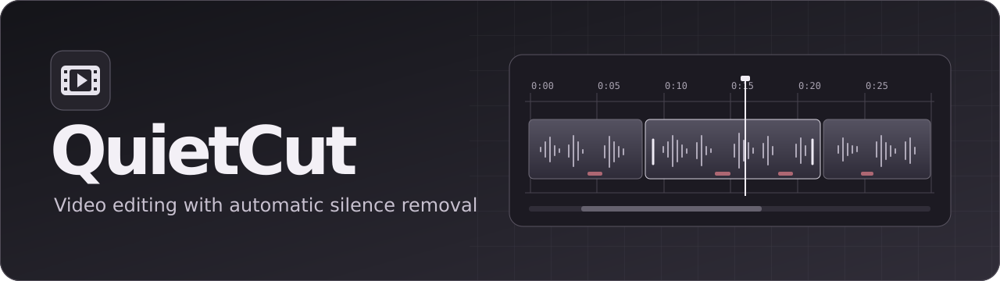
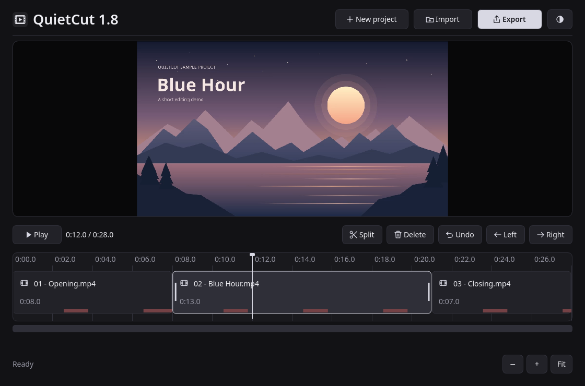
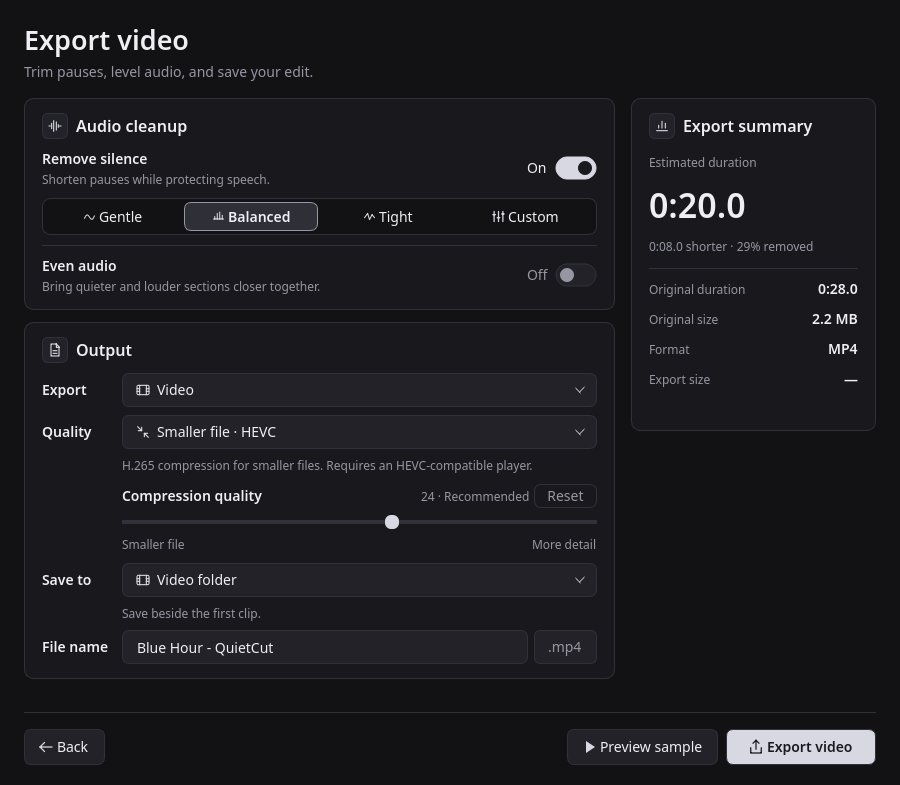
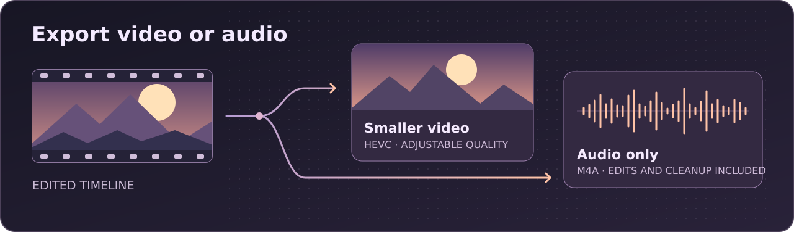

# QuietCut

Trim and reorder video clips, shorten pauses, and export files on your device.
The Linux and Windows editors use Rust and FFmpeg. The Android app uses Android's
built-in media codecs.

| Platform | Get QuietCut |
| --- | --- |
| Linux · amd64 | [Debian package](https://github.com/altarafiya/quietcut/releases/download/v1.8.0-5/quietcut_1.8.0-5_amd64.deb) |
| Windows 10/11 · x64 | [Windows editor notes](docs/windows-1.8.md) |
| Android 10+ | [Android source](android/) |

## Edit on the timeline



Import or drop videos, scrub the ruler, and drag clip edges to trim. Move clips
on the track, split at the playhead, or undo an edit. The red strips mark
detected pauses that QuietCut will skip when silence removal is enabled.

## Preview and export on Linux





- **Smaller file · HEVC** Start at quality **24** and use **Preview sample**
  to check up to eight seconds before encoding the full edit. Lower numbers
  preserve more detail. H.265 playback requires a compatible player.
- **Audio only · M4A** Export your edited audio as AAC, with silence removal
  and audio leveling available. No video is encoded.
- **Fast copy** Keeps the video stream and cuts at keyframes. It turns off
  silence removal. **Lossless** preserves the retained frames pixel for pixel.
  The two H.264 presets trade size against detail and offer wider compatibility.

QuietCut uses NVIDIA encoding when the encoder and driver support it, with
software encoding available as a fallback. File-size savings vary by source
and selected quality.

The [audio-only export window](docs/media/audio.png) keeps the same audio cleanup
controls and hides video quality settings.

Screenshots show QuietCut running on Linux with the illustrated Blue Hour demo.

## Install on Linux

Download the amd64 package from [Releases](https://github.com/altarafiya/quietcut/releases)
and install it through APT. It was tested on PikaOS 4 and needs glibc 2.39 or newer,
FFmpeg, and the Qt 6 Python multimedia bindings from your distribution.

```sh
sudo apt install ./quietcut_1.8.0-5_amd64.deb
```

Open **QuietCut** from the application menu, or run `quietcut`.

## Run on Windows

QuietCut runs on Windows 10 and 11 (x64). Install FFmpeg and add its `bin`
directory to PATH, or place `ffmpeg.exe` and `ffprobe.exe` in a `tools` folder
beside QuietCut. See the [Windows 1.8 notes](docs/windows-1.8.md) for the native
editor's controls and export modes.

## Use on Android

QuietCut runs on Android 10 and newer. Add videos to preview, trim, and
reorder them. Export to H.264 MP4, HEVC MP4 on supported devices, or audio-only
M4A. QuietCut saves exports in **Downloads/QuietCut**.

**Auto** prefers a hardware video encoder and can fall back to software if
hardware encoding fails. Use **Video encoder** to choose a codec the device
reports for the selected format. QuietCut shows the encoder it used after export.

## Build from source

- **Linux** Install Rust and Cargo, a C compiler, binutils, and the Debian
  packaging tools. Run `sh linux/build-deb.sh ./dist`. See the
  [Linux notes](linux/README.md) for playback and export behavior.
- **Windows** Build with the Rust MSVC toolchain and the Windows SDK.
  See the [Windows 1.8 notes](docs/windows-1.8.md).
- **Android** Install JDK 17 and Android SDK Platform 35. Set `ANDROID_HOME`,
  then run `cd android && ./gradlew :app:assembleDebug` (use `gradlew.bat` on Windows).

QuietCut is available under the [MIT license](LICENSE). See the
[third-party notices](THIRD-PARTY-NOTICES.md) for dependency licenses.
